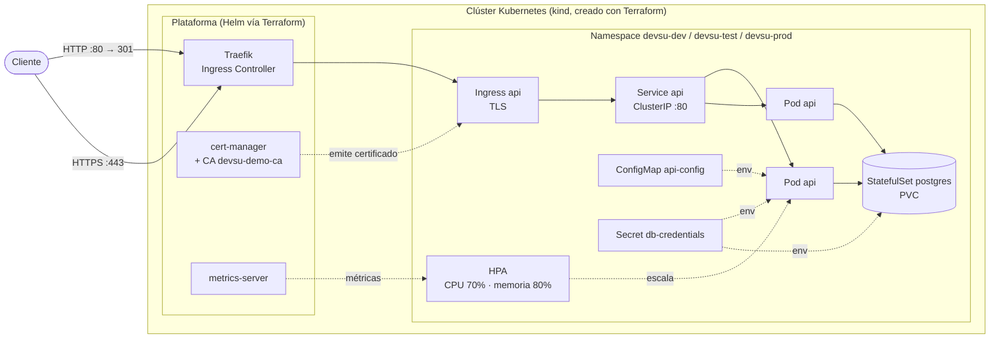
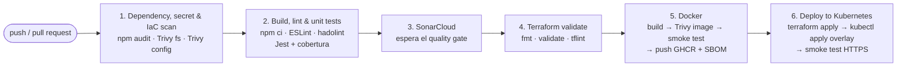
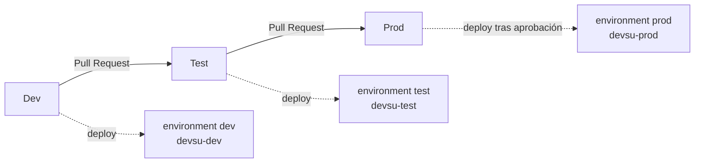

# Demo DevOps Node.js

[](https://github.com/FavioRonaldo/devsu-demo-devops-nodejs/actions/workflows/ci-cd.yml)
[](https://sonarcloud.io/dashboard?id=FavioRonaldo_devsu-demo-devops-nodejs&branch=Dev)
[](https://sonarcloud.io/dashboard?id=FavioRonaldo_devsu-demo-devops-nodejs&branch=Dev)

Solución de la prueba técnica DevOps de Devsu sobre la aplicación `demo-devops-nodejs`: una API REST de usuarios (Express + Sequelize) dockerizada, desplegada en Kubernetes con escalamiento horizontal, con un pipeline CI/CD como código y la plataforma creada con Terraform.

## Entregables

| Entregable | Enlace |
|---|---|
| Repositorio público | https://github.com/FavioRonaldo/devsu-demo-devops-nodejs |
| Ejecución del pipeline | https://github.com/FavioRonaldo/devsu-demo-devops-nodejs/actions/runs/40273843952 |
| Historial de ejecuciones | https://github.com/FavioRonaldo/devsu-demo-devops-nodejs/actions/workflows/ci-cd.yml |
| Imagen Docker pública (GHCR) | https://github.com/FavioRonaldo/devsu-demo-devops-nodejs/pkgs/container/devsu-demo-devops-nodejs |
| Análisis estático y cobertura (SonarCloud) | https://sonarcloud.io/dashboard?id=FavioRonaldo_devsu-demo-devops-nodejs&branch=Dev |
| Evidencia de Terraform (`plan` / `apply` / `output`) | [docs/terraform](docs/terraform) |

Cada ejecución del pipeline publica en su página un resumen con la cobertura, la imagen publicada y el estado de los recursos de Kubernetes desplegados, además de los artefactos `coverage` y `terraform-<ambiente>`.

## Contenido

1. [Arquitectura](#arquitectura)
2. [La aplicación](#la-aplicación)
3. [Docker](#docker)
4. [Kubernetes](#kubernetes)
5. [Pipeline CI/CD](#pipeline-cicd)
6. [Infraestructura como código (Terraform)](#infraestructura-como-código-terraform)
7. [Seguridad](#seguridad)
8. [Ejecución local](#ejecución-local)
9. [Puntos no cubiertos y por qué](#puntos-no-cubiertos-y-por-qué)
10. [Recomendaciones para producción](#recomendaciones-para-producción)
11. [Estructura del repositorio](#estructura-del-repositorio)

## Arquitectura



| Capa | Tecnología |
|---|---|
| Aplicación | Node.js 24, Express 4, Sequelize 6 |
| Base de datos | PostgreSQL 17 (SQLite en desarrollo y pruebas) |
| Contenedor | Imagen multi-stage sobre `node:24.21.0-alpine3.24` |
| Registro | GitHub Container Registry (`ghcr.io`) |
| Orquestación | Kubernetes 1.35 (kind), manifiestos con Kustomize |
| Ingress / TLS | Traefik + cert-manager |
| CI/CD | GitHub Actions |
| Calidad y seguridad | ESLint, hadolint, Jest, SonarCloud, npm audit, Trivy, tflint |
| IaC | Terraform (providers `tehcyx/kind` y `hashicorp/helm`) |

## La aplicación

API REST para crear y consultar usuarios.

| Método | Ruta | Respuesta exitosa | Errores |
|---|---|---|---|
| `GET` | `/api/users` | `200` lista de usuarios | `500` |
| `GET` | `/api/users/:id` | `200` usuario | `400` id inválido, `404` no existe, `500` |
| `POST` | `/api/users` | `201` usuario creado | `400` campos faltantes o DNI duplicado, `500` |
| `GET` | `/health` | `200 {"status":"ok"}` (liveness) | — |
| `GET` | `/ready` | `200 {"status":"ready"}` (readiness, verifica la base de datos) | `503` |

Ejemplo:

```bash
curl -X POST http://localhost:8000/api/users \
  -H 'Content-Type: application/json' \
  -d '{"dni": "0102030405", "name": "Favio"}'
```

### Variables de entorno

| Variable | Valor por defecto | Descripción |
|---|---|---|
| `PORT` | `8000` | Puerto HTTP |
| `DATABASE_DIALECT` | `sqlite` | `sqlite` o `postgres` |
| `DATABASE_NAME` | `./dev.sqlite` | Nombre de la base (postgres) o ruta del archivo (sqlite) |
| `DATABASE_HOST` | `localhost` | Host de PostgreSQL |
| `DATABASE_PORT` | `5432` | Puerto de PostgreSQL |
| `DATABASE_USER` | — | Usuario de PostgreSQL |
| `DATABASE_PASSWORD` | — | Contraseña de PostgreSQL |
| `DATABASE_LOGGING` | `false` | Log de las consultas SQL |
| `SHUTDOWN_TIMEOUT_MS` | `10000` | Tiempo máximo del apagado ordenado |

### Cambios realizados al código base

El proyecto original no podía ejecutarse correctamente en contenedores ni con varias réplicas. Estos fueron los cambios y su motivo:

| Problema encontrado | Cambio |
|---|---|
| Puerto fijo en el código | Toda la configuración se lee de variables de entorno ([shared/config.js](shared/config.js)) |
| `host:` en lugar de `storage:` en Sequelize: la base SQLite vivía en memoria y nunca se creaba `dev.sqlite` | Corregido en [database.js](shared/database/database.js) |
| `sync({ force: true })` borraba las tablas en cada arranque | `sync()` sin borrar datos |
| SQLite local: con 2 o más réplicas cada pod tendría datos distintos | Soporte para PostgreSQL; SQLite queda para desarrollo y pruebas |
| `dotenv` estaba en `devDependencies` pero se usa en runtime: la imagen de producción no arrancaba | Movido a `dependencies` |
| Sin endpoints de salud | `/health` (liveness) y `/ready` (readiness con verificación de la base) |
| Sin manejo de `SIGTERM` | Apagado ordenado: deja de aceptar conexiones, termina las peticiones en curso y cierra la base |
| Errores no controlados devolvían HTML | Manejadores JSON para `404`, JSON inválido (`400`) y `500`; cabecera `X-Powered-By` desactivada |
| Dependencias con vulnerabilidades críticas y altas (express, body-parser, path-to-regexp, tar, lodash…) | Actualizadas dentro de la misma versión mayor |
| 3 pruebas con mocks y sin cobertura | 23 pruebas contra una base en memoria, cobertura del 100 % con umbral mínimo del 80 % |
| Sin linter | ESLint 10 |

La separación entre [app.js](app.js) (la aplicación Express) e [index.js](index.js) (arranque del servidor) permite probar la API sin abrir un puerto. `index.js` queda fuera de la cobertura unitaria y se valida con las pruebas de humo del contenedor y de Kubernetes.

### Pruebas

```bash
npm ci
npm run lint
npm test
npm run test:coverage
```

## Docker

[Dockerfile](Dockerfile) · [docker-compose.yml](docker-compose.yml) · [.dockerignore](.dockerignore)

| Práctica | Implementación |
|---|---|
| Multi-stage | La etapa `deps` instala solo dependencias de producción (`npm ci --omit=dev`); la imagen final no tiene herramientas de build |
| Imagen base fija | `node:24.21.0-alpine3.24`, nunca `latest` |
| Parches del sistema | `apk upgrade` en cada build, para incluir correcciones publicadas después de la imagen base |
| Usuario sin privilegios | `USER node` (uid 1000); el código pertenece a root y es de solo lectura, solo `/app/data` es escribible |
| Superficie mínima | Se eliminan `npm`, `npx` y `corepack` de la imagen final; el `.dockerignore` excluye pruebas, secretos e infraestructura |
| Puerto | `EXPOSE 8000`, configurable con `PORT` |
| Variables de entorno | `NODE_ENV=production` y valores por defecto de la base de datos |
| Chequeo de salud | `HEALTHCHECK` contra `/health` con `wget` |
| Señales | `CMD ["node", "index.js"]` en forma exec, para que Node reciba `SIGTERM` directamente |
| Trazabilidad | Etiquetas OCI; el pipeline publica SBOM y provenance con cada imagen |

La imagen funciona sola con SQLite o con PostgreSQL:

```bash
docker run -p 8000:8000 ghcr.io/favioronaldo/devsu-demo-devops-nodejs:dev
```

`docker compose up` levanta la API con PostgreSQL. La API espera a que la base esté `healthy` y corre con sistema de archivos de solo lectura, sin capabilities y con `no-new-privileges`.

## Kubernetes

Los manifiestos usan Kustomize: una base común en [k8s/base](k8s/base) y un overlay por ambiente en [k8s/overlays](k8s/overlays).

| Recurso | Propósito |
|---|---|
| `Namespace` | Un namespace por ambiente con Pod Security Admission `restricted` |
| `Deployment api` | 2 réplicas, rolling update sin indisponibilidad (`maxUnavailable: 0`), init container que espera a PostgreSQL, `preStop` para drenar conexiones |
| Probes | `startupProbe` y `livenessProbe` en `/health`, `readinessProbe` en `/ready` |
| `HorizontalPodAutoscaler` | Escala por CPU (70 %) y memoria (80 %), con estabilización de 5 minutos al reducir |
| `PodDisruptionBudget` | Mantiene réplicas disponibles durante mantenimientos del clúster |
| `topologySpreadConstraints` | Reparte las réplicas entre nodos |
| `Service api` | ClusterIP en el puerto 80 |
| `Ingress api` | Host por ambiente, TLS emitido por cert-manager, redirección HTTP → HTTPS en Traefik |
| `ConfigMap api-config` | Configuración no sensible (generado por Kustomize con hash: un cambio reinicia los pods) |
| `Secret db-credentials` | Usuario y contraseña de la base (generado desde `secrets.env`, que no se versiona) |
| `StatefulSet postgres` + `PVC` | Base de datos con almacenamiento persistente |
| `ServiceAccount` | Cuenta dedicada sin token montado |
| `NetworkPolicy` | Denegar por defecto; solo Traefik llega a la API y solo la API llega a PostgreSQL |
| `ResourceQuota` y `LimitRange` | Límites de consumo por namespace y valores por defecto |

Todos los contenedores, incluida la base de datos, corren sin root, con sistema de archivos de solo lectura, sin capabilities, sin escalamiento de privilegios y con perfil seccomp `RuntimeDefault`.

### Diferencias por ambiente

| | dev | test | prod |
|---|---|---|---|
| Namespace | `devsu-dev` | `devsu-test` | `devsu-prod` |
| Host | `api.dev.devsu-demo.local` | `api.test.devsu-demo.local` | `api.devsu-demo.local` |
| Réplicas (HPA) | 2–3 | 2–4 | 3–6 |
| PDB `minAvailable` | 1 | 1 | 2 |
| Recursos de la API | 100m / 128Mi → 500m / 256Mi | igual que dev | 200m / 192Mi → 750m / 384Mi |
| Almacenamiento PostgreSQL | 1Gi | 1Gi | 5Gi |

### Validaciones realizadas en el clúster

Además de la prueba de humo de cada despliegue, se validó lo siguiente en un clúster kind de 3 nodos:

| Prueba | Resultado |
|---|---|
| kubeconform en los tres overlays | 16/16 recursos válidos por ambiente |
| Réplicas repartidas | Un pod por worker |
| Datos tras reiniciar PostgreSQL y la API | Persisten |
| Peticiones mientras se elimina un pod | 0 fallidas de 40 |
| Pod ajeno intentando conectarse a PostgreSQL | Bloqueado por la NetworkPolicy |
| HPA bajo carga | CPU al 242 % → escaló de 2 a 3 réplicas |

## Pipeline CI/CD

Definido en [.github/workflows/ci-cd.yml](.github/workflows/ci-cd.yml).



Los jobs se ejecutan en serie, de lo más rápido y barato a lo más costoso: si un control falla, el pipeline se detiene antes de construir o publicar nada. El análisis de dependencias va primero porque no necesita compilar; SonarCloud usa la cobertura generada en el paso anterior y bloquea el pipeline si el quality gate falla; la infraestructura se valida antes de publicar la imagen, y solo una imagen que pasó todos los controles llega al despliegue.

| Paso requerido | Implementación |
|---|---|
| Construcción de código | `npm ci` con Node 24 y caché de npm |
| Pruebas unitarias | Jest (23 pruebas) |
| Análisis de código estático | ESLint, hadolint y SonarCloud (el pipeline espera y exige el quality gate) |
| Cobertura del código | Jest con umbral del 80 %; reporte lcov a SonarCloud y resumen en la ejecución |
| Construir y subir la imagen | Buildx con caché, push a GHCR con SBOM y provenance |
| Escaneo de vulnerabilidades (opcional) | `npm audit`, Trivy sobre dependencias, secretos, Dockerfile, manifiestos, Terraform y la imagen final; resultados SARIF en la pestaña Security |
| Despliegue a Kubernetes | Terraform crea el clúster y la plataforma, Kustomize genera los manifiestos del ambiente y se verifica por HTTPS |

La imagen solo se publica si pasa el escaneo de vulnerabilidades y una prueba de humo del contenedor (endpoints, `HEALTHCHECK` en `healthy` y usuario no-root). El despliegue usa exactamente esa imagen, identificada por la etiqueta inmutable `sha-<commit>`.

### Ramas y ambientes



| Evento | Qué se ejecuta |
|---|---|
| Pull Request hacia `Dev`, `Test` o `Prod` | Todo excepto la publicación de la imagen y el despliegue |
| Push a `Dev` / `Test` / `Prod` | Pipeline completo y despliegue al ambiente correspondiente |
| Despliegue a `prod` | Requiere aprobación manual (GitHub Environments) |

| Etiqueta de imagen | Uso |
|---|---|
| `sha-<commit>` | Inmutable, la usa el despliegue |
| `dev`, `test`, `prod` | Última versión publicada en cada ambiente |
| `latest` | Solo desde `Prod` |

Cada environment solo acepta despliegues desde su rama. Las credenciales de la base de datos (`DATABASE_USER`, `DATABASE_PASSWORD`) son secretos de cada environment y `SONAR_TOKEN` es un secreto del repositorio; ninguno está en el código.

### Por qué el despliegue usa un clúster efímero

Se eligió una infraestructura local, sin nube pública. Un runner de GitHub no puede alcanzar un clúster que corre en una máquina personal, por lo que el pipeline crea con Terraform un clúster kind dentro del runner y despliega ahí los mismos manifiestos que se usan localmente. Así el despliegue queda probado y visible públicamente en cada ejecución. Para un clúster persistente, el mismo job funciona cambiando la creación del clúster por las credenciales de ese clúster (por ejemplo, un `KUBECONFIG` guardado como secreto del environment).

## Infraestructura como código (Terraform)

Código en [terraform](terraform), evidencia en [docs/terraform](docs/terraform).

| Recurso | Descripción |
|---|---|
| `kind_cluster.this` | Kubernetes 1.35: 1 control-plane y 2 workers, puertos 80/443 hacia el Ingress |
| `helm_release.metrics_server` | Métricas para el HPA |
| `helm_release.cert_manager` | Emisión de certificados |
| `helm_release.traefik` | Ingress Controller, redirección HTTP → HTTPS |
| `helm_release.cluster_issuer` | CA propia y `ClusterIssuer` (chart local en [terraform/charts](terraform/charts)) |

- Versiones de Terraform, providers y charts fijadas; `.terraform.lock.hcl` versionado con checksums para Linux, Windows y macOS.
- `create_cluster = false` instala la plataforma en un clúster existente, como el de Docker Desktop (`kube_context`).
- Los outputs incluyen las URLs de cada ambiente y la línea a agregar en el archivo `hosts`.
- El pipeline ejecuta `fmt`, `validate` y `tflint` en cada cambio, y `plan` / `apply` en cada despliegue.

Se usa Traefik porque el proyecto ingress-nginx fue archivado por la comunidad de Kubernetes; los recursos de la aplicación siguen siendo `Ingress` estándar.

## Seguridad

| Control | Detalle |
|---|---|
| Dependencias | `npm audit` y Trivy bloquean el pipeline ante vulnerabilidades HIGH o CRITICAL con corrección disponible |
| Imagen | Trivy sobre la imagen final antes de publicarla |
| Configuración | Trivy revisa Dockerfile, manifiestos y Terraform (0 hallazgos HIGH/CRITICAL) |
| Secretos | Trivy busca secretos en el código; las credenciales viven en GitHub Environments |
| Cadena de suministro | Trivy se instala desde su release oficial verificando el checksum; acciones y herramientas con versión fija; SBOM y provenance en cada imagen |
| Runtime | Contenedores sin root, solo lectura, sin capabilities, Pod Security `restricted`, NetworkPolicies |

**Riesgo aceptado:** `uuid` < 11.1.1 (severidad moderada), dependencia transitiva de Sequelize 6. La falla requiere pasar un `buffer` a las funciones v3/v5/v6 y Sequelize solo usa v1/v4 sin `buffer`, por lo que no es explotable en esta aplicación. Se resuelve al migrar a Sequelize 7.

## Ejecución local

Requisitos: Node.js 22 o superior. Para contenedores: Docker. Para Kubernetes: Docker, Terraform ≥ 1.9 y kubectl.

### Node.js

```bash
npm ci
npm start
```

La API queda en http://localhost:8000/api/users usando SQLite (`dev.sqlite`).

### Docker Compose

```bash
docker compose up --build
```

### Kubernetes

1. Crear el clúster y la plataforma:

   ```bash
   cd terraform
   terraform init
   terraform apply
   cd ..
   ```

   Para usar el Kubernetes de Docker Desktop en lugar de kind: `terraform apply -var create_cluster=false`.

2. Crear las credenciales y desplegar un ambiente:

   ```bash
   cp k8s/overlays/dev/secrets.env.example k8s/overlays/dev/secrets.env
   kubectl apply -k k8s/overlays/dev
   kubectl -n devsu-dev rollout status deployment/api
   ```

3. Agregar al archivo `hosts` (`C:\Windows\System32\drivers\etc\hosts` o `/etc/hosts`) la línea que muestra `terraform output hosts_file_entry`:

   ```
   127.0.0.1 api.dev.devsu-demo.local api.devsu-demo.local api.test.devsu-demo.local
   ```

4. Probar (el certificado lo firma la CA local, por eso `-k`):

   ```bash
   curl -k https://api.dev.devsu-demo.local/api/users
   bash scripts/smoke-test.sh https://api.dev.devsu-demo.local -k
   ```

5. Eliminar todo: `terraform -chdir=terraform destroy`.

## Puntos no cubiertos y por qué

| Punto | Motivo |
|---|---|
| URL pública del endpoint | Se eligió una infraestructura local sin costo, sin nube pública. El despliegue se verifica en cada ejecución del pipeline y puede reproducirse localmente con los pasos anteriores |
| Infraestructura en un proveedor público (puntos extra) | Mismo motivo. Terraform crea el clúster y toda la plataforma de forma local; para nube se reemplaza `kind_cluster` por un clúster gestionado (AKS, EKS o GKE) y se configura un backend remoto para el estado |

## Recomendaciones para producción

- **DNS:** un dominio real apuntando al balanceador del Ingress, por ejemplo con ExternalDNS.
- **TLS:** cert-manager con un `ClusterIssuer` de Let's Encrypt en lugar de la CA propia.
- **Secretos:** External Secrets Operator con un gestor de secretos (Azure Key Vault, AWS Secrets Manager, Vault) o Sealed Secrets, en lugar de `secretGenerator`.
- **Base de datos:** un servicio gestionado (Azure Database for PostgreSQL, Amazon RDS, Cloud SQL) con alta disponibilidad, backups automáticos y recuperación a un punto en el tiempo.
- **Migraciones:** reemplazar `sequelize.sync()` por migraciones versionadas ejecutadas en un `Job` antes del despliegue.
- **Despliegue continuo:** GitOps con Argo CD o Flux, que sincronizan el clúster desde el repositorio.
- **Observabilidad:** métricas con Prometheus y Grafana, logs centralizados (Loki o el servicio del proveedor) y trazas con OpenTelemetry.
- **Terraform:** estado remoto con bloqueo (Azure Storage, S3 + DynamoDB o Terraform Cloud) y un `plan` revisado en cada Pull Request.
- **Seguridad:** firma de imágenes con cosign, políticas de admisión (Kyverno o Gatekeeper) y Dependabot o Renovate para mantener las dependencias al día.
- **Escalamiento:** Cluster Autoscaler o Karpenter para que el clúster crezca junto con el HPA.

## Estructura del repositorio

```
.
├── .github/
│   ├── actions/setup-trivy/     Instalación verificada de Trivy
│   └── workflows/ci-cd.yml      Pipeline CI/CD
├── docs/terraform/              Evidencia de terraform plan/apply/output
├── k8s/
│   ├── base/                    Recursos comunes (api, postgres, namespace)
│   ├── overlays/                dev, test y prod
│   └── platform/                Valores de Traefik
├── scripts/smoke-test.sh        Prueba de humo usada por el pipeline
├── shared/                      Configuración, base de datos, middlewares y esquemas
├── terraform/                   Clúster kind y plataforma
├── test/                        Pruebas unitarias
├── users/                       Rutas, controlador y modelo de usuarios
├── app.js                       Aplicación Express
├── index.js                     Arranque del servidor y apagado ordenado
├── Dockerfile
├── docker-compose.yml
└── sonar-project.properties
```
